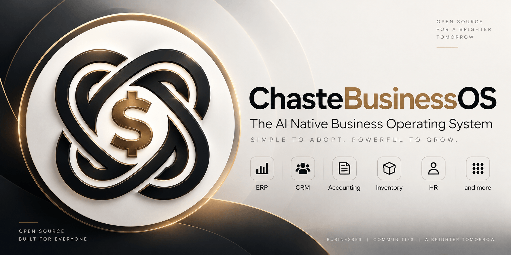

<div align="center">



# ChasteBusinessOS

**The agentic ERP. Describe your business, and an AI co-worker runs it under your authority.**

[](https://github.com/benaiah-muga/ChasteBusinessOS/releases)
[](https://github.com/benaiah-muga/ChasteBusinessOS/actions/workflows/ci.yml)
[](LICENSE)
[](tsconfig.base.json)
[](ROADMAP.md)
[](CONTRIBUTING.md)

[](VISION.md)
[](ARCHITECTURE.md)
[](ROADMAP.md)
[](CONTRIBUTING.md)
[](CODE_OF_CONDUCT.md)
[](SECURITY.md)
[](CHANGELOG.md)

[Features](#features) · [Quick start](#quick-start) · [How it works](#how-it-works) · [Demos](#demo-proofs) · [Docs](#documentation) · [Contributing](#contributing) · [License](#license)

</div>

---

Most ERPs fail at adoption, not at features. Teams spend months implementing them and years clicking through every screen by hand. ChasteBusinessOS takes a different position: you describe your business in plain language, an AI co-worker configures and operates as much as possible on your behalf, and every action it takes passes through the same governance yours does.

It cannot spend above your approval threshold without sign-off. It cannot assign itself a role. When it meets something it can't do, it files a ticket instead of improvising.

## Features

| Area | What works today |
|---|---|
| **Accounting** | Double-entry GL with immutable postings and mirror reversals, AR/AP subledgers, period close, trial balance, P&L, balance sheet, direct-method cash flow, customer and supplier statements, 13-week cash forecast |
| **Approvals** | Human-in-the-loop gates on money above thresholds; identity and destructive actions always require a person |
| **Audit** | Append-only hash-chained event ledger of everything humans and agents did; replayable agent session trajectories |
| **Sales** | Reservation-anchored orders: confirming checks credit headroom and reserves stock, delivery consumes reservations and invoices exactly what shipped, oversell is refused |
| **CRM** | Leads, deals pipeline with weighted forecasting, lead conversion, tasks with due dates, duplicate detection, and a customer 360 timeline merging invoices, payments, quotes, deals and tasks |
| **POS** | Register sessions, atomic cash/card sales, drawer counting with variance flagging, always-gated full-sale returns, and per-register shift summaries |
| **Purchasing** | Vendors, bills, purchase orders with goods receipts and three-way matching, payment terms, supplier price history and lead-time memory, close-with-backorder |
| **Inventory** | Append-only stock ledger with moving-average valuation, reorder alerts, reservations, cycle counts, locations, lots, internal transfers, barcodes, and GL reconciliation |
| **Manufacturing** | Multi-level BOMs with scrap allowances, work orders, production runs with full reversal, lot traceability, can-we-produce-N planning |
| **People & projects** | Employee structure, attendance with late flags, derived leave balances, recruitment-lite through to hire, projects kanban, and expense claims with policy limits and duplicate detection |
| **Marketing** | Saved deterministic segments, campaigns with opt-out honoured at send time, and the append-only send log as the analytics (no tracking pixels) |
| **Support** | Helpdesk tickets with numbers, priority/category/SLA, canned responses, KB articles, and SLA-breach signals |
| **Documents** | Folders, business-record links, and append-only version history with expiry signals |
| **Understanding** | `analytics.explainChange` decomposes a revenue change into exact, property-tested contributions with drill-to-invoice; `askYourBusiness` answers from cited extracts and proposes a governed action |
| **Signals** | Cross-module needs-attention registry: deterministic producers aggregated red-first with evidence and a suggested governed action |
| **Routines** | The agent on a schedule in plain language, running headless under a least-privilege bundle, silent on `NO_ACTION`, triggerable by webhook |
| **Messaging** | Team channels and DMs; the agent participates under its own authority |
| **Creator Mode** | The agent proposes platform changes as governed artifacts; humans merge |

## Quick start

Requirements: Node 24+ (matches CI), pnpm 11+, Go 1.27.1 (pinned in
`.go-version`), Postgres 16 **with pgvector**, and - optionally - one model
provider key (NVIDIA NIM ([build.nvidia.com](https://build.nvidia.com)) by
default, or OpenRouter, Groq, Mistral, or Z.ai (GLM) via `MODEL_PROVIDER`).

**Docker is not required.** The commands below use it for the database because
it is the shortest path, but [docs/SETUP.md](docs/SETUP.md) covers three
options - Docker, a hosted Postgres (Neon/Supabase/Railway, no containers at
all), and a native Postgres install - along with a troubleshooting table.

```sh
git clone https://github.com/benaiah-muga/ChasteBusinessOS.git
cd ChasteBusinessOS
pnpm install

cp .env.example .env        # add NVIDIA_API_KEY, BETTER_AUTH_SECRET, and SMTP settings

docker run -d --name chaste-pgvector \
  -e POSTGRES_PASSWORD=chaste_dev -e POSTGRES_USER=chaste \
  -e POSTGRES_DB=chaste_os_v2 -p 5433:5432 pgvector/pgvector:pg16

pnpm --filter @chaste/db db:migrate
pnpm db:provision-runtime
pnpm dev                    # React/Vite app on :3000
# In another terminal, run the Go API on :8080:
pnpm dev:api
# In another terminal, run the Go capability/routine and outbox workers:
pnpm worker
```

`pnpm worker` loads the repository `.env`, builds the four Go workers (jobs,
outbox, marketing email outbox, notification email outbox), and runs them with
signal forwarding for graceful shutdown. Routine scheduling and the Go routine
agent runner are opt-in for local work: set `GO_ROUTINE_SCHEDULER=1` or
`GO_ROUTINE_AGENT_RUNNER=1` to enable them. The jobs worker uses
`JOBS_WORKER_DATABASE_URL` and `GO_DATABASE_URL`, the outbox worker uses
`OUTBOX_WORKER_DATABASE_URL`, the marketing email worker uses
`MARKETING_EMAIL_OUTBOX_WORKER_DATABASE_URL` and the SMTP settings, and the
notification email worker uses
`NOTIFICATION_EMAIL_OUTBOX_WORKER_DATABASE_URL`. Marketing campaign messages
are rechecked against the current customer email, active status, and opt-out
flag before delivery; its database login can read only campaign email rows and
the customer fields needed for that check.

Go mounts its API route families by default, including onboarding, setup, and
dashboard, and Vite sends those requests to Go. Set a route's `GO_*_ROUTE`
switch to `0` to unmount it; the request then returns Go's 404 or 405 instead of
falling back to a second server. The Vite setup and dashboard selectors
(`CHASTE_GO_SETUP_ROUTE`, `CHASTE_GO_DASHBOARD_ROUTE`) default on and pick the
exact Go route. If HTTPS terminates before Go, set `GO_API_TRUSTED_PROXY_CIDRS`
to the exact reverse-proxy peer CIDRs so Go can verify the forwarded scheme
without accepting another origin, and set `CHASTE_GO_API_ORIGIN` to the Vite
development proxy's Go target (the proxy accepts cleartext HTTP only for
loopback hosts).

Settings SMTP status and test sends, plus Accounting invoice email, use the Go
`/api/email` route. Go verifies the session or bearer token and derives the
organization server-side. Configure `SMTP_HOST`, `SMTP_PORT`, `SMTP_SECURE`,
`SMTP_USER`, `SMTP_PASS`, and `SMTP_FROM` for delivery. Set
`GO_PUBLIC_APP_URL` to the public app origin when invoice emails are sent by
bearer clients; cookie-authenticated browser requests use their validated
same-origin URL when this setting is empty.

## Why React and Go: measured build benefits

We chose React and TypeScript on Vite to shorten frontend compile feedback and
catch type errors early, and Go for fast, capable APIs and workers. This
benchmark shows the build-time improvement measured so far; type safety and
end-to-end request speed are migration goals that these build numbers do not
measure.

**Measured 2026-10-01**, on Linux x64 with an Intel Core i7-4600U, Node
24.18.0, pnpm 11.9.0, and Go 1.27.1. Each command ran three times in sequence
with shared dependency and compiler caches left warm between runs.

| Build | Command | Median | p95 | Median peak RSS |
| --- | --- | ---: | ---: | ---: |
| Next.js | `pnpm --filter web build` | 34.90 s | 340.19 s | 886,408 kB |
| Vite + React + TypeScript | `pnpm --filter @chaste/web-vite build` | 25.77 s | 27.20 s | 739,596 kB |
| Go API and workers | `go -C apps/api build ./cmd/api ./cmd/jobs-worker ./cmd/outbox-worker` | 4.41 s | 4.59 s | 255,360 kB |

In this sample, the Vite build median is about **26% lower** than the Next.js
median, and its median peak memory use is about **17% lower**. The three Go
binaries build in a **4.41-second median** with a 255,360 kB median peak RSS.
These are the compilation, build-time, and peak-memory benefits measured so
far in the migration.

The first Next.js run was cold and took 340.19 s; the next two took 34.02 s
and 34.90 s. With only three samples, p95 reflects this cold-build outlier.
The Vite command includes TypeScript checking. The full samples, peak memory,
and toolchain details are in the
[benchmark report](docs/migration/benchmarks/phase-4-previews.json) for
revision [`9bcce00`](https://github.com/benaiah-muga/ChasteBusinessOS/commit/9bcce00fc019cf24c1ab16db7b8cfd2ee78e3b21).

This snapshot compares build commands while the Vite app still has less feature
coverage than the existing app. It does not measure edit-to-ready or browser
navigation, so it is a build-time baseline rather than an end-to-end
development-speed claim. Refresh the report with:

```sh
pnpm benchmark:migration:builds --runs 3 --output docs/migration/benchmarks/phase-4-previews.json
```

The separate development-server startup sample, measured 2026-10-01 on the
same machine with three alternating runs and warm caches, recorded a lower
Vite median in this sample:

| Dev server | Command | Median process-spawn to TCP-listener time |
| --- | --- | ---: |
| React + Vite app | `pnpm dev:vite` | 2.767 s |

The Next.js compatibility app those samples compared against was retired in the
React/Go migration, so the benchmark now measures the Vite server alone.
This measurement records when the server first accepts a TCP connection,
not when a route finishes rendering or becomes usable in a browser. The full
samples, method, and machine details are in the
[startup benchmark report](docs/migration/benchmarks/phase-4-startup.json) for
revision [`cedea09`](https://github.com/benaiah-muga/ChasteBusinessOS/commit/cedea09abf54834d8b75f36a1d204110eed4fe48).
Refresh it with:

```sh
pnpm benchmark:migration:startup --runs 3 --output docs/migration/benchmarks/phase-4-startup.json
```

Edit-to-ready, route navigation, and demo-fixture comparisons remain to be
measured before claiming an end-to-end development-speed improvement.

## Routing and operations

Vite owns the browser and talks to Go for every API request. In development,
Vite's proxy sends each `/api` path to `CHASTE_GO_API_ORIGIN` (default
`http://127.0.0.1:8080`); exact `CHASTE_GO_*` selectors pick methods and paths
for Go routes. In the Compose stack, nginx serves the built client and forwards
`/api/*` to the Go API. Unmounted paths return Go's 404 or 405; nothing falls
back to a second server.

### Go mounts and capability gates

Go mounts its route families by default. A family's `GO_*_ROUTE` switch (for
example `GO_NOTIFICATIONS_ROUTE` or `GO_DASHBOARD_ROUTE`) set to `0` unmounts
it. Two routes require an explicit `1`: `GO_SESSION_CAPABILITY_ROUTE`, which
mounts the authenticated session capability route, and `GO_CRM_READ_ROUTE`,
which mounts the CRM collection GET.

Inside the session capability route, these capability slices stay disabled
until set to `1`: `GO_MANUFACTURING_DEFINE_BOM_SLICE`,
`GO_INVENTORY_CYCLE_COUNT_WRITES`, `GO_PURCHASING_AP_AGING_READS`, and
`GO_PURCHASING_WORKFLOW_READS`. Read slices (`GO_DOCUMENT_INGESTED_READS`,
`GO_DOCUMENTS_EDITOR_READS`, `GO_DOCUMENTS_VERSION_READS`,
`GO_MESSAGING_PEOPLE_READS`) are enabled unless set to `0`.

Provide a fresh `GO_INTERNAL_AUTH_SECRET` of at least 32 random bytes in every
environment (`openssl rand -hex 32`); it signs the internal capability
assertions used by scripts and is verified by the Go API.

### Vite selectors

The `CHASTE_GO_*` selectors pick exact methods and paths in the Vite
development proxy. Route and read selectors default on. Three capability
slices need an explicit `1` and also need `CHASTE_GO_SESSION_CAPABILITY_ROUTE=1`
on Vite with `GO_SESSION_CAPABILITY_ROUTE=1` on the API, because they call Go
capabilities directly with the browser session:
`CHASTE_GO_INVENTORY_ITEM_SLICE`, `CHASTE_GO_PROJECTS_WRITES`, and
`CHASTE_GO_PURCHASING_PAYMENT_RUNS`. `.env.example` lists the current switches
with comments, and `docs/migration/route-ownership.json` is the checked-in
route census.

### Authentication

Go owns the whole `/api/auth` namespace and mounts it whenever
`BETTER_AUTH_SECRET` is set; `GO_AUTH_MODE` must be `development` or
`production` and selects the origin and cookie behavior. Production mode
requires `GO_AUTH_PUBLIC_ORIGIN` to be an HTTPS origin and
`GO_AUTH_SECURE_COOKIE=true`. Vite has no auth selector: its `/api` catch-all
sends every method and path under `/api/auth` to Go, and unsupported Better
Auth paths return 404 or 405. Invitation routes mount with auth. If HTTPS
terminates upstream, set `GO_AUTH_TRUSTED_PROXY_CIDRS`. Verification and
recovery emails go through a PostgreSQL outbox with bounded backoff; configure
the `SMTP_*` settings for delivery.

- **OIDC**: set `GO_OIDC_ENABLED=1` with the issuer, client credentials, and the
  registered callback URI. The callback validates issuer, signature, audience,
  nonce, state, and PKCE before creating a Go-owned session and never stores
  provider tokens. `GO_OIDC_ALLOWED_ENDPOINT_HOSTS` allows discovery endpoints
  on exact `host[:port]` authorities when they differ from the issuer; every
  endpoint must use HTTPS, and only authorities you trust accept configuration.
  Set `GO_OIDC_TRUST_VERIFIED_EMAIL=true` only when the issuer attests
  `email_verified`. Native clients can opt in with
  `GO_OIDC_NATIVE_REDIRECT_URI` and exchange the short-lived code at
  `POST /api/auth/native/exchange` with the PKCE verifier.
- **SAML**: set `GO_SAML_ENABLED=1` and pin the IdP issuer, HTTPS SSO endpoint,
  signing certificate, SP entity ID, ACS URL, success URL, and attribute
  names. The IdP must sign the SAML response, and verified-email linking
  requires `GO_SAML_TRUST_VERIFIED_EMAIL=true`.
- **SCIM**: `GO_SCIM_READ_ROUTE` (default on) serves SCIM 2.0 user reads;
  `GO_SCIM_WRITE_ROUTE` (default on) provisions and deactivates through
  governed capabilities; `GO_SCIM_TOKENS_ROUTE` (default on) manages hashed,
  unexpired bearer tokens. Standard SCIM clients can omit `Idempotency-Key`;
  retries deduplicate within each membership generation.

### Support widget and work brief

`GO_SUPPORT_PUBLIC_ROUTE` (default on) mounts the public
`/api/support/public` widget, which uses NVIDIA embeddings for published
knowledge search; configure `NVIDIA_API_KEY` and `GO_SUPPORT_EMBEDDING_MODEL`.
Run the jobs worker with `GO_SUPPORT_EMBEDDING_WORKER=1` to index published
articles. Set `GO_SUPPORT_TRUSTED_PROXY_CIDRS` only for trusted reverse proxy
networks.

`GO_MY_WORK_SUMMARY_ROUTE` (default on) serves the work brief at
`POST /api/my-work/summarize` using the signed-in user's own default OpenCode
connection with tools disabled, or their isolated Codex home in read-only CLI
mode. Missing runtimes, unsupported providers, and provider failures return an
error without substituting workspace credentials.

Manufacturing and marketing capabilities run on the Go executor and worker
behind the Go-owned `GET`/`POST /api/manufacturing` and `GET`/`POST
/api/marketing` session routes.

For a production-shaped local Docker run, use the Vite and Go Compose stack:

```sh
cp .env.example .env       # set BETTER_AUTH_SECRET and GO_INTERNAL_AUTH_SECRET
docker compose up -d --build
curl http://localhost:3000/api/health
```

Compose builds the React/Vite client as static assets served by nginx and the
Go API, capability jobs worker, webhook outbox worker, marketing email outbox
worker, and notification email outbox worker as standalone Go services. A
one-shot setup step creates the least-privilege Go app role
principal, then a second applies Drizzle migrations and requires a matching
PostgreSQL 16 `pg_dump` snapshot. Final role grants are provisioned after
migrations, before the API and workers start. The API
connects to Compose Postgres at `db:5432` as `chaste_app`; nginx serves the
client and forwards `/api/*` to Go on the private Compose network. The
development database is published on port 5433 by default. Set
`CHASTE_POSTGRES_PASSWORD` and `CHASTE_APP_DB_PASSWORD` together if you change
the local credentials. Set `CHASTE_STRICT_MIGRATION_BACKUP=0` only when
intentionally running migrations on disposable data without a snapshot.

Local Compose defaults Go auth to `GO_AUTH_MODE=development` and trusts
`http://localhost:3000`. For a production deployment, set
`GO_AUTH_MODE=production`, `GO_AUTH_PUBLIC_ORIGIN` to the HTTPS browser origin,
and `GO_AUTH_SECURE_COOKIE=true`. When TLS terminates upstream, configure
`GO_AUTH_TRUSTED_PROXY_CIDRS`, `GO_API_TRUSTED_PROXY_CIDRS`, and
`GO_SUPPORT_TRUSTED_PROXY_CIDRS` with only the exact proxy networks used in
your topology. Provide a fresh `GO_INTERNAL_AUTH_SECRET` of at least 32 random
bytes in every environment.

Migration snapshots persist in the `chaste-pg-backups` named volume and remain
available after the migrator container is recreated. Export backups to your
deployment's durable backup store; `docker compose down -v` deletes this volume
along with the local database volume.

`node scripts/verify-docker.mjs` builds and starts this stack on isolated ports,
checks a pre-migration snapshot, the Vite page, both proxied and direct Go
health endpoints, and an auth request's same-origin handling through nginx.
It then removes the containers and temporary database volume.

Sign up, describe your business in two sentences, and the workspace builds itself: chart of accounts seeded, description embedded into org memory, owner role granted to you.

## How it works

One rule holds the whole system together: there is exactly one way to change state, and humans and agents share it.

```
intent → resolve capability → validate input → check permissions
      → policy evaluation → [execute | request approval]
      → append to ledger → notify
```

Clicking "pay invoice" in the UI and typing "pay the Acme invoice" in chat reach the same executor with the same capability ID. One path means one place for security review, and automatic parity between what you can do and what your AI co-worker can do.

Capabilities carry their own contract: zod schemas, risk class (`read`, `write`, `money`, `identity`, `destructive`), permission reference, and an inverse action so state changes stay reversible. The registry validates all of it at boot; a module declaring an inverse that doesn't exist refuses to start the server.

## Verification

`pnpm verify:vite-go` builds the active Vite client and runs Go tests and vet.
CI combines that explicit active-stack check with the full typecheck, lint,
and test gates, migration manifests, database continuity checks, and live
business proofs when their provider key is available. The Next.js production
build is not required, and every demo proof runs through the Go assertion
bridge (`scripts/lib/go-driver.ts`).

## Demo proofs

Each script is an executable specification. If one fails, that's a bug worth knowing about.

```sh
pnpm demo:slice   # customer → invoice → gated payment → approval → trial balance
pnpm demo:m2      # AR aging, period-close gating, agent posts to internal chat
pnpm demo:m3      # document ingestion → coding suggestions → vendor bill → payment
pnpm demo:m4      # vendor bill → gated payment → P&L and balance sheet prove out
pnpm demo:m4b     # hire → leave → prorated payroll → approval → ledger
pnpm demo:m5      # register session → sales → drawer variance flagged
pnpm demo:m6      # teams/RBAC, inventory, three-way matching, Creator Mode
pnpm demo:support # customer care agent grounded in records, injection refused
pnpm demo:m7      # inventory → GL reconciliation, transfers, products
pnpm demo:m8      # needs-attention signals, governed reorder approve/decline
pnpm demo:m9      # quote-to-cash: fulfillment, credit guard, expiry, customer 360
pnpm demo:m10     # cash flow, credit notes, statements, reminders, forecast
pnpm demo:m11     # hire → project → time → expense → approve
pnpm demo:m12     # revenue decomposition, ask-your-business, tickets, documents
pnpm demo:m13     # POS returns, shift summaries, marketing-lite
```

Most take a subcommand to run one proof, e.g. `pnpm demo:m9 fulfillment`.
Every demo needs a migrated database. Some also drive the real agent and need a
model provider key - CI skips the keyed demo set when no key is configured, so
a missing key looks like a skipped job rather than a failure.

Demo scripts run through the authenticated Go assertion bridge
(`scripts/lib/go-driver.ts`). Point `CHASTE_GO_API_ORIGIN` (or
`GO_API_INTERNAL_URL`) at the running Go API (`pnpm dev:api`), set
`GO_DATABASE_URL` to the provisioned `chaste_app` connection, and set
`GO_INTERNAL_AUTH_SECRET` to at least 32 bytes
(`openssl rand -hex 32`), then run the proof.

## Upgrading

Updates ship as new app code plus incremental database migrations. Your data
survives updates: migrations are additive `ALTER`s applied in place by
Drizzle's idempotent migrator, and a `pg_dump` snapshot is taken
automatically before any migration runs.

```sh
git pull            # get the new version
pnpm install
pnpm --filter @chaste/db db:migrate  # local development, explicit
pnpm dev                             # local development
```

For production, `docker compose up -d --build` runs the `migrate-schema` and
`migrate` one-shot services before the API and workers start, so a deployment
never serves new code against an old schema. Local development migrates
explicitly to keep restarts quick.

Controls and safety nets:

- Pre-migration snapshots live in `packages/db/backups/` (newest 10 kept).
  Restore one with `psql "$DATABASE_URL" < <snapshot>.sql` after stopping the
  app. Snapshots use the host `pg_dump`, falling back to the one inside the
  database container when the host client is missing or older than the
  server; override with `CHASTE_PG_DUMP_BIN` (a command with flags) or rename
  the container with `CHASTE_DB_CONTAINER`.
- Set `CHASTE_STRICT_MIGRATION_BACKUP=1` in production to refuse migrating
  when a snapshot cannot be taken (e.g. `pg_dump` not installed and no
  container fallback available).
- Upgrade notes for behavioral changes are in [CHANGELOG.md](CHANGELOG.md)
  under the version you're moving to.

## Documentation

- [Setup guide](docs/SETUP.md), local setup with or without Docker, plus troubleshooting
- [Vision](VISION.md), what we're building and what we won't compromise
- [Architecture](ARCHITECTURE.md), capability kernel, governance pipeline, memory tiers
- [Roadmap](ROADMAP.md), milestones and standing principles
- [ADRs](docs/adr/), why things are the way they are
- [Changelog](CHANGELOG.md), every behavioral change, per Keep a Changelog

## Contributing

Read [AGENTS.md](AGENTS.md) even if you're human. It defines the conventions, the verification gate (typecheck, lint, tests, then break a demo), and the rules for authoring new capabilities. Significant decisions get an ADR; behavioral changes get a changelog entry.

See [CONTRIBUTING.md](CONTRIBUTING.md) and our [Code of Conduct](CODE_OF_CONDUCT.md).

## Security

Found something exploitable? Please report privately per [SECURITY.md](SECURITY.md) rather than opening an issue.

## License

[Apache License 2.0](LICENSE)
