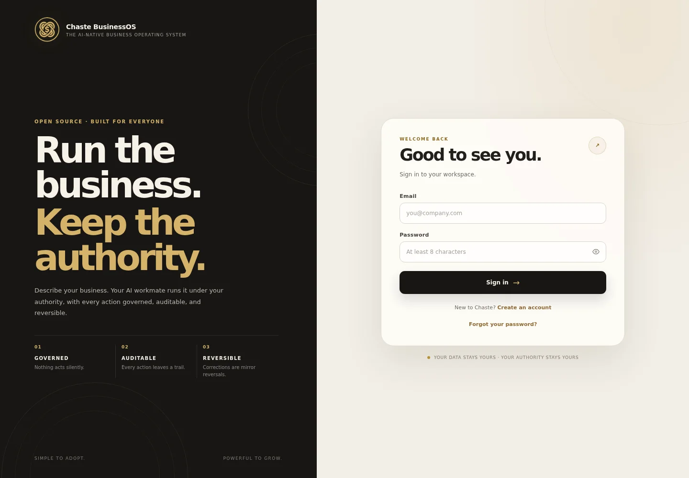
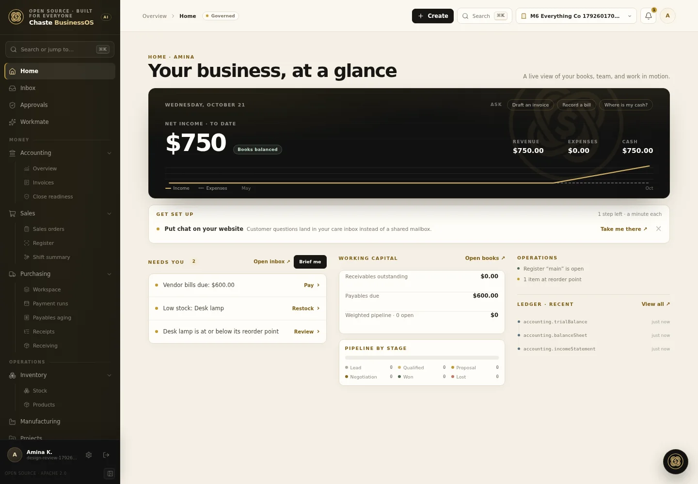
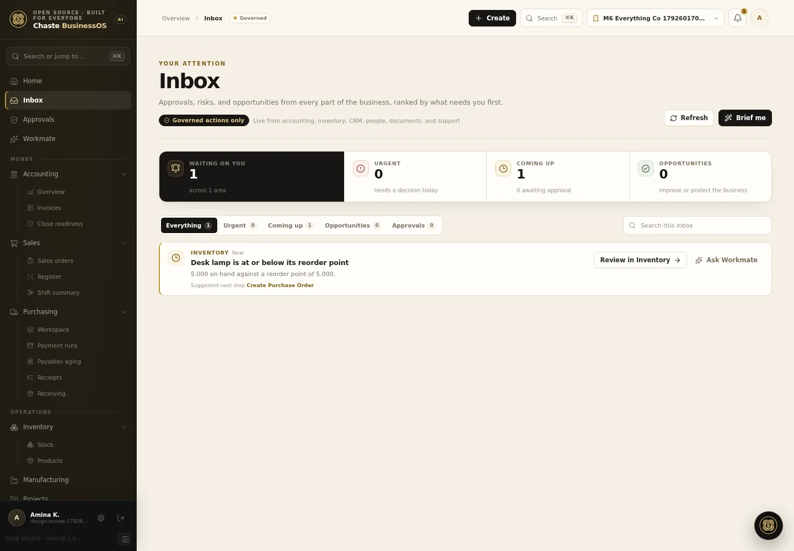
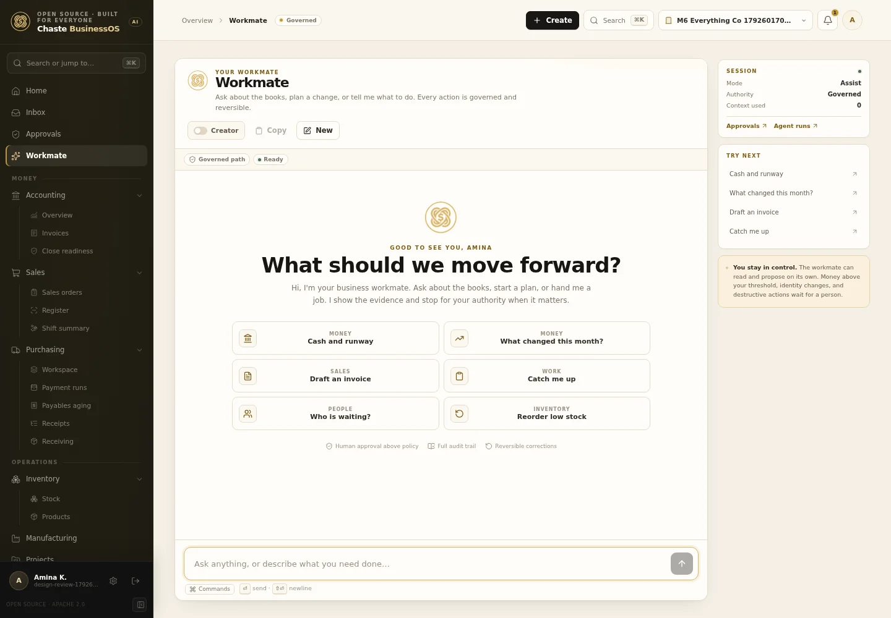
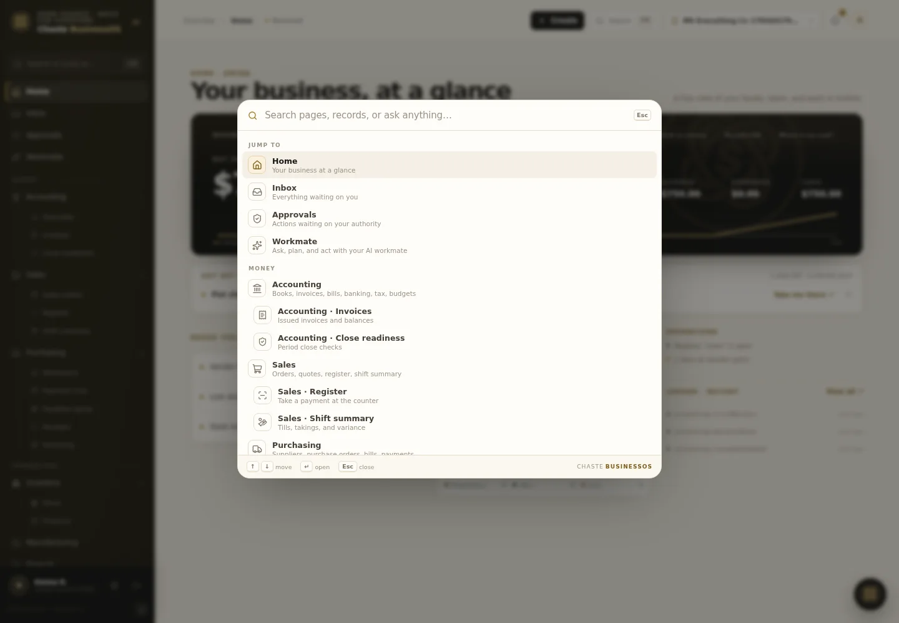
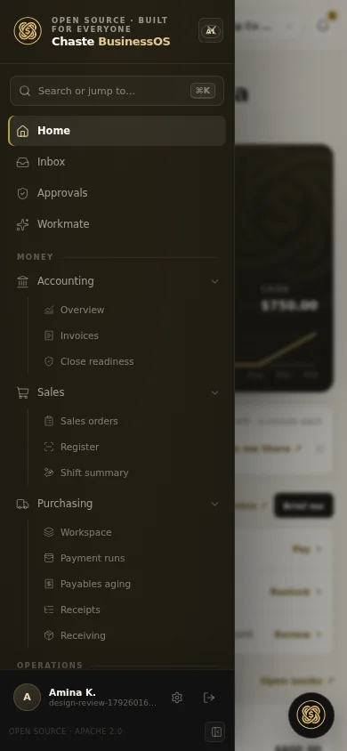

# Brand and experience direction, October 2026

Status: implemented foundation, with a prioritized backlog
Scope: the Vite product shell, Workmate, Inbox, Settings, and shared UI primitives
Brand source: `assets/chastelogo.jpg` and the campaign image `assets/banner.png`

## The direction in one sentence

Chaste should feel like a private operating room for a serious business: warm paper, inked surfaces, restrained gold, and one obvious next move on every screen.

## What was wrong

The React and Go migration kept the product working but lost much of the product experience that had been designed earlier:

- Twenty-eight flat rail links with no groups, no search, and no mobile navigation.
- A green-led palette that did not match the black, gold, and warm paper brand.
- A generic letter "C" where the real mark exists.
- Page headings split between Georgia, system sans, and hand-rolled sizes.
- A Workmate conversation with no history, no starters, no commands, and no context.
- An unused `/api/signals` backend feed with no human surface.
- A Creator workflow that asked people to "connect a coding agent" with no way to do it.
- Internal implementation language ("Go workspace", "Go governed", "Go payment runs") leaking into customer copy.
- A hardcoded UGX formatter in CRM even when the workspace recorded USD.

## Brand system

The identity in the image is built from four materials, not "a gold accent".

| Token | Value | Role |
| --- | --- | --- |
| `--ink-950` | `#111110` | Rail, masthead, primary buttons |
| `--ink-900` | `#171613` | Product ink, login panel |
| `--paper-200` | `#f4efe5` | Canvas |
| `--paper-50` | `#fffdf8` | Cards and reading surfaces |
| `--gold-500` | `#c19a32` | Emphasis, active states, data highlights |
| `--gold-300` | `#e2c98f` | Gold on dark surfaces |
| `--line` | `#e5dccb` | Hairlines and table rules |

Supporting rules:

- Gold is never used as a large fill behind white text. Primary actions are ink.
- Semantic color stays semantic: sage for healthy, clay for danger, amber for attention.
- The display face is the system grotesque with tight tracking. Editorial serif is reserved for the login story, portal, and print, where it carries the brand rather than the workflow.
- The real interlocking-loop mark is used in the rail, login, Workmate, dock, loader, favicon, and touch icon. The mark is transparent and has a gold variant for dark surfaces.
- The loading state is a custom orbit: a gold ring, the real mark, a breathing scale, and a spark. It replaces the old "Loading workspace page..." string.

Assets live in `apps/web-vite/public/brand/`. The favicon is hand-drawn SVG so it stays crisp at tab size.

## Shell and information architecture

The rail is grouped by the user's mental model, not by backend route ownership:

- Overview: Home, Inbox, Approvals, Workmate.
- Money: Accounting, Sales, Purchasing, each with its real sub-surfaces.
- Operations: Inventory, Manufacturing, Projects.
- Relationships: CRM, Marketing, Support, Proposals.
- People: People, Team.
- Company: Documents, Messages, Analytics, Ledger, Agent runs, Marketplace, Settings.

Supporting behaviors:

- ⌘K or Ctrl+K opens a command palette with grouped navigation, quick asks, and a fallback that sends any unmatched query to Workmate.
- A visible Create menu turns the agent into the universal quick-create path for invoices, bills, customers, products, expenses, and reordering.
- The rail can collapse to icons. On narrow screens it becomes a drawer with a scrim, Escape handling, and body scroll lock.
- Active parents and children both expose `aria-current`; the rail uses Lucide icons rather than mixed glyphs.
- The top bar carries breadcrumbs, governance status, search, Create, organization switching, notifications, and the account menu.
- Approvals are polled for a live badge, except on Inbox and Approvals where the page already owns the read.
- A skip link, visible focus rings, reduced-motion support, and a keyboard shortcut sheet set the accessibility floor.

## Inbox

Inbox is the human triage surface that was missing. It combines the unused business signal feed with pending approvals:

- Ranked by severity: urgent, coming up, opportunities.
- Filter chips with live counts and search.
- Each row states the module, the evidence, the suggested governed action, and two next steps: open the owning workspace, or ask Workmate to resolve it.
- A "Brief me" action summarizes the visible queue through the existing my-work summarizer.
- Loading, error, empty, and filtered-empty states are all explicit.

This is deliberately not another dashboard. It is a work queue with actions.

## Workmate

The chat surface now follows the conversation patterns that modern agent UIs have converged on, without copying a template:

- A welcome state with grouped starters for money, work, people, and inventory.
- A persistent session card for mode, authority, context tokens, approvals, and agent runs.
- Slash commands (`/invoice`, `/bill`, `/cash`, `/report`, `/brief`, `/reorder`, `/approvals`).
- A session context meter, step and tool strip, stop and queue controls, clarification cards, record cards, proposal cards, and token feedback.
- Copy transcript, new-conversation confirmation, and a clear statement that the old thread remains in Agent runs.
- No purple "agent" color. The workmate is gold and ink like the brand.

The floating dock uses the same store and the same visual language, so the conversation survives resizing.

## Command palette

The product already had a design-system seam but no component primitive layer. We adopted the shadcn approach rather than its default look:

- Radix primitives: Dialog, Dropdown Menu, Popover, Tooltip, and Toast.
- `class-variance-authority`, `clsx`, and `cmdk` for component contracts and the command menu.
- Custom CSS tokens and component classes in `src/ui/`, not the default Tailwind palette.
- Shadcn's AI Elements chatbot example informed the conversation, message, prompt input, suggestion, context, tool, and confirmation surfaces. The useful patterns are conversation scrolling, a rich prompt input with attachments and a model picker, message branches, reasoning, sources, and a streaming loader.
- We adopted the composition, not the demo: conversation, message, prompt input, suggestions, context, tool activity, clarifications, proposal cards, queueing, and stop. Attachments, branches, and the model selector are deliberately deferred until the backend can support them.
- No generic shadcn dashboard, login, or chat block was pasted in. The layout, type, color, and motion are specific to this product.

## Mobile

## What OpenCode 2 offers, and what we can use

OpenCode 2 is an open-source coding agent with a terminal, desktop, web, and HTTP API surface. The parts that matter to Chaste are not the code editing itself; they are the interaction contracts around an agent doing work.

| OpenCode 2 capability | Where it maps in Chaste | Status |
| --- | --- | --- |
| Session list, get, fork, active, context, diff, interrupt, compact | Agent runs, Workmate recent runs and session deep links, fork a conversation, manually compact a long run | Recent runs and deep links shipped; fork and manual compact next |
| Permission rules with allow, ask, deny and last-match precedence | Approval policy explanations and the authority preview before a run | Next |
| Snapshots and revert (`/undo`, `/redo`) | Revert a governed run or restore a prior conversation checkpoint | Next |
| Attachments with text, image, and line-range references | Attach an invoice, document, or screenshot to Workmate | Next |
| Compaction with a structured objective, decisions, blockers, next moves | A plain-language compaction card in long sessions and a context budget indicator | Compaction card shipped; budget indicator next |
| MCP servers and custom tools | The governed Chaste capability surface exposed to OpenCode | Connection UI shipped |
| Warming, providers, and models | Runtime health, provider selection, and connection status in Settings | Partly shipped |
| Pairing and web access | Share a read-only Agent run with a reviewer | Next |
| Skills and commands | Reusable Workmate playbooks and slash commands | Commands shipped, skills next |
| Worktrees | Not relevant to ERP records | Not planned |

The concrete integration shipped here is the OpenCode 2 connection card in Settings > AI & automation. It connects to a local OpenCode server, stores the server password encrypted, configures the governed MCP tools, can set the runtime as default, and disconnects it. That closes a real product gap: Creator mode told people to connect a coding agent but gave them no control to do it.

## Prioritized next proposals

These are valuable even where the backend is not ready. Each has a clear user problem.

1. **Session rail and fork.** Let people see recent Workmate sessions, name them, fork at a message, and resume. Backend support: session list and fork already exist in OpenCode; Chaste has `/api/sessions` and replay, but chat needs a conversation identifier and a fork endpoint.
2. **Checkpoint and revert.** A visible "Revert to here" action on assistant turns, with a diff of affected records, not source files. Requires a per-turn receipt and record-level snapshots.
3. **Context attachments.** Attach an invoice, customer, document, or image to a prompt. Backend needs multipart ingest and a prompt contract; the UI should show source chips and let people remove a source without rewriting the prompt.
4. **Cross-record search.** The command palette should search customers, invoices, bills, documents, products, and tickets, not just pages. Backend needs an org-scoped search endpoint with type, snippet, and permission-aware results.
5. **Universal quick create.** Move from "start with the workmate" to inline drawers for the most common records, with the agent filling fields from context and a review step before commit.
6. **Bulk triage.** Inbox needs select-all, snooze, assign, and "ask Workmate to handle these" for signals. Backend needs signal state, assignment, and dismissal events.
7. **Approval plan preview.** Before a money action, show the exact journal lines, stock movements, and policy threshold. This is a trust feature, not decoration.
8. **Saved views everywhere.** CRM has them. Accounting, Purchasing, Inventory, and Support should share the same saved-view contract, including pinned views and share links.
9. **Data-table keyboard model.** Arrow navigation, inline edit, undo, density control, and column pinning for the dense tables.
10. **Notification preferences.** Per-category email and in-app controls, quiet hours, and a digest. The notification feed is live; the preferences surface is not.
11. **Mobile approvals.** A focused approval route with swipe or large-target decisions, optional push, and a biometric re-auth before high-risk actions.
12. **Run sharing.** A signed, read-only link to a Workmate run, with sensitive payload redaction. This pairs with OpenCode's pairing model.
13. **Agent runtime health.** A Settings card that shows OpenCode version, provider readiness, MCP tool registration, and last error. The API already returns a runtime object.
14. **Compaction transparency.** The compaction card now states how many recent messages were kept. Next, summarize what changed in the summary and link to the full run.
15. **Dark and high-contrast modes.** The token layer is ready. Add `data-mode` tokens, test the gold on ink contrast, and expose Light, Dark, and System.

## Verification

- `pnpm typecheck`, `pnpm lint`, and the Vite test suite cover the shell, login, Workmate, notifications, inbox, and new primitives.
- The changed routes were opened in the running app at 1440x1000 and 390x844, including the mobile drawer and the command palette.
- The logo, loader, focus rings, and contrast were checked in the browser, not only in source.

## References

- [OpenCode 2 introduction](https://opencode.ai/v2/docs/)
- [OpenCode 2 snapshots](https://opencode.ai/v2/docs/snapshots/)
- [OpenCode 2 compaction](https://opencode.ai/v2/docs/compaction/)
- [OpenCode 2 permissions](https://opencode.ai/v2/docs/permissions/)
- [OpenCode 2 attachments](https://opencode.ai/v2/docs/attachments/)
- [OpenCode 2 HTTP API](https://opencode.ai/v2/docs/api)
- [OpenCode 2 warming](https://opencode.ai/v2/docs/warming/)
- [shadcn/ui Vite installation](https://ui.shadcn.com/docs/installation/vite)
- [shadcn/ui AI Elements](https://ui.shadcn.com/docs/ai-elements)
- [shadcn/ui AI Elements chatbot example](https://elements.ai-sdk.dev/examples/chatbot)
- [shadcn/ui chat components changelog](https://ui.shadcn.com/docs/changelog/2026-06-chat-components)
